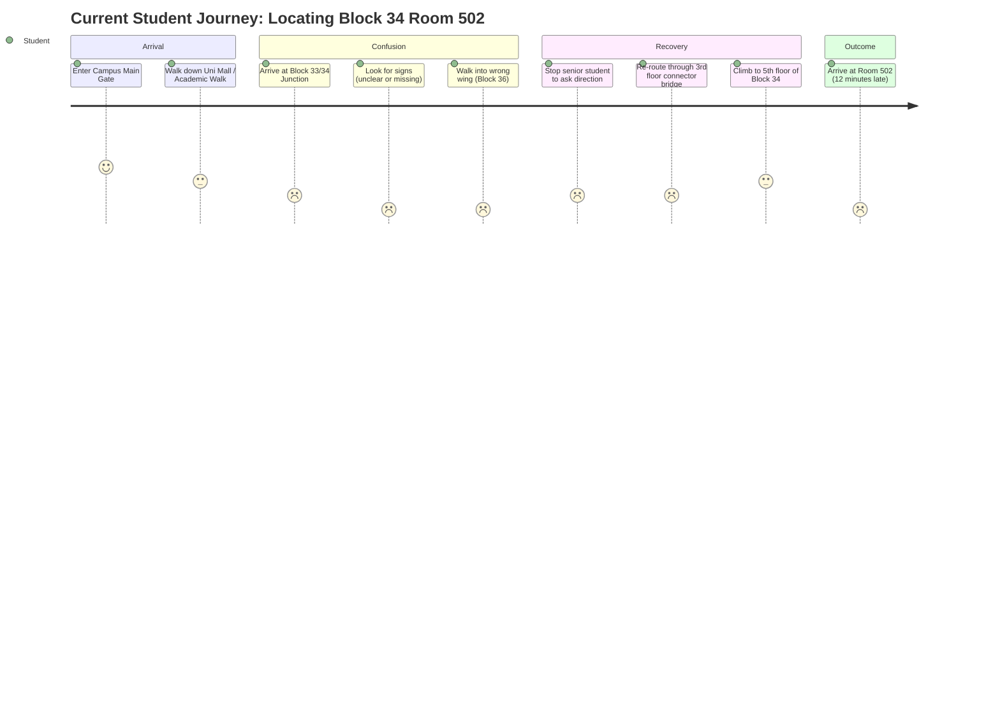
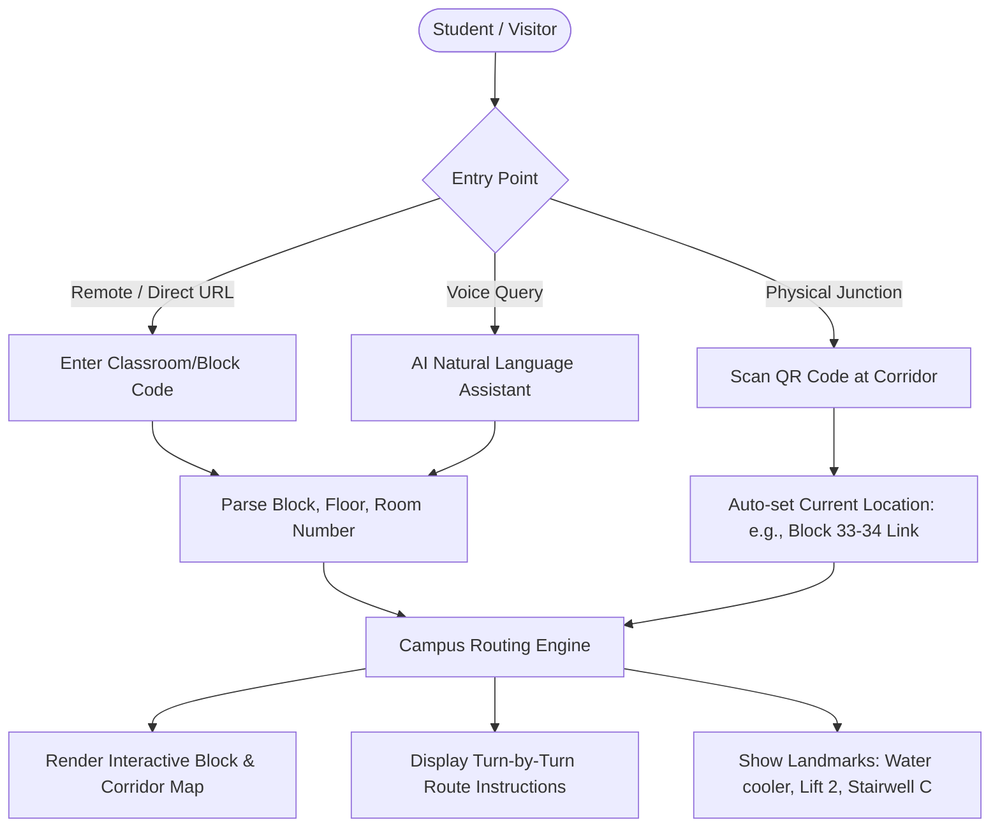

# Continuous Assessment 2 (CA2) — Design Thinking Project Report
## Project Code & Title: P10: Which Block is 34? — Smart Campus Navigation System
**Target Ecosystem:** Lovely Professional University (LPU) Campus Wayfinding  
**Submission Drive Link:** [Google Drive Submission Folder](https://drive.google.com/drive/folders/1kaoEALkLw2l0SB1W9PndeJpRoxTz10Ll?usp=drive_link)

---

### Project Team Composition

| Role | Student Name | Registration No. | Class Roll No. | Email Address |
| :--- | :--- | :--- | :--- | :--- |
| **Team Leader** | **Namrata Kumari** | — | **25** | namratakumari2211@gmail.com |
| **Team Member 1** | Shahzadi.c | 12526252 | 28 | — |
| **Team Member 2** | Abhay Jaiswal | 12504556 | 24 | — |
| **Team Member 3** | Arman | 11218773 | 19 | — |

*Total Group Members:* **4**  
*Current Design Thinking Milestone:* **Stage 4: Prototype & Stage 5: User Testing (Functional Web Prototype Delivered)**

---

## 1. Executive Summary

Navigating a massive multi-hundred-acre university campus with over 60 multi-story academic buildings, residential halls, and facilities presents a formidable challenge for new students, freshers, visitors, and guest faculty. At institutions like Lovely Professional University (LPU), this spatial challenge is compounded by architectural configurations where multiple numbered blocks are physically joined into uninterrupted structural wings (e.g., the contiguous cluster of **Blocks 33, 34, 35, 36, 37, and 38**, as well as **Blocks 55, 56, and 57**).

Our Design Thinking initiative, titled **"P10: Which Block is 34?"**, tackles the widespread phenomenon of student disorientation, chronic first-period tardiness, and cognitive friction during campus navigation. Grounded in primary empirical research gathered through **16 in-person user survey questionnaires**, our findings reveal that **81.3%** of respondents experience difficulty locating blocks or rooms, **87.5%** have missed or arrived late to lectures due to navigation failure, and **87.5%** rely entirely on stopping other students to ask for directions because existing maps and signage are ambiguous.

Through the Stanford d.school 5-stage Design Thinking methodology (**Empathize, Define, Ideate, Prototype, Test**), our team conceptualized, engineered, and tested an integrated, high-accessibility solution: the **LPU Smart Campus Navigator & QR Pathfinder**. This solution bridges physical campus architecture with digital wayfinding through QR-coded junction waypoints, classroom-level precision search (e.g., locating "Block 34, 5th Floor"), and an AI-driven natural language destination assistant.

---

## 2. Background & Problem Context

Modern university campuses are designed like miniature smart cities. However, while municipal navigation relies on street addresses and GPS navigation, university indoor and micro-campus wayfinding falls into an informational blind spot:
1. **Satellite GPS Ineffectiveness:** Standard mobile tools like Google Maps only pin the external perimeter of massive buildings and cannot distinguish between interconnected wings, indoor corridors, or vertical levels (e.g., distinguishing Block 34 from adjacent Block 35 or navigating to the 5th floor).
2. **The "Merged Block" Maze:** As observed across multiple student survey responses, buildings like 34, 35, 36, 37, and 38 are connected via continuous indoor corridors and skybridges. A student entering at Block 33 can walk 400 meters indoors without realizing they have crossed invisible internal block boundaries.
3. **Elevated Academic Stress:** New students during their initial weeks face severe anxiety trying to reach lecture halls before biometric attendance windows close, leading to frustration, embarrassment, and missed instructional time.

---

## 3. Phase 1: EMPATHIZE — User Research & Survey Analysis

To gain deep qualitative and quantitative empathy with the student body, our group conducted in-person field interviews and distributed structured questionnaires across diverse campus hotspots (academic corridors, central library, food courts, and hostel walkways).

### 3.1 Primary Survey Dataset (N = 16)
The raw dataset of 16 completed user survey sheets was transcribed, validated, and categorized.

#### Quantitative Survey Breakdown

| Metric / Question | Primary Options & Responses | Count (N=16) | Percentage (%) |
| :--- | :--- | :--- | :--- |
| **Q1. Difficulty finding blocks or classrooms?** | • Yes<br>• Sometimes<br>• No | 5<br>8<br>3 | 31.25%<br>50.00%<br>18.75% |
| **Friction Rate (Yes + Sometimes)** | Experiencing navigation difficulties | **13 / 16** | **81.25%** |
| **Q2. Biggest problem faced while finding locations?** | • Difficulty finding classrooms<br>• Lack of direction boards<br>• Difficulty finding block numbers<br>• Confusing campus map | 5<br>4<br>4<br>3 | 31.25%<br>25.00%<br>25.00%<br>18.75% |
| **Q3. Action taken when lost?** | • Ask other students<br>• Follow direction boards<br>• Ask security guards<br>• Use Google Maps | 14<br>2<br>1<br>0 | 87.50%<br>12.50%<br>6.25%<br>0.00% |
| **Q4. Ever been late because of incorrect location?** | • Yes<br>• Sometimes<br>• No | 7<br>7<br>2 | 43.75%<br>43.75%<br>12.50% |
| **Tardiness Incident Rate (Yes + Sometimes)** | Impacted attendance / lost instructional time | **14 / 16** | **87.50%** |
| **Q5. Preferred solution that would help most?** | • Better direction boards (physical signage)<br>• Digital campus map<br>• Clear block numbers<br>• QR code navigation<br>• Mobile navigation system | 8<br>6<br>3<br>2<br>1 | 50.00%<br>37.50%<br>18.75%<br>12.50%<br>6.25% |

*(Note: In Q2 and Q5, some respondents selected multiple high-priority items).*

---

### 3.2 Deep Qualitative Insights from Student Voices

The open-ended responses in **Q6 (Which place do you find most difficult to locate?)** and **Q7 (Suggestions to improve campus navigation?)** revealed the exact architectural pain points:

1. **The Interconnected Block Cluster (Blocks 33–38):**
   - **Aman Kumar Gupta (Survey #3):** *"Block like 35, 36, 37, 38 all are merge so that was most difficult... There should be a proper guidance of each Block."*
   - **Deshraj Kumar (Survey #7):** *"In between block 36, 37 and 38 I found difficult to locate classrooms. Yes, there should be a QR code navigation in which users can scan the QR and locate their respective classrooms."*
   - **Venkat (Survey #12):** Explicitly identified *"34-block - 5th floor"* as the most difficult location to reach, validating our project title **"Which Block is 34?"**.
   - **Prakhar Maheshwari (Survey #4) & Ananthakrishnan (Survey #14):** Highlighted *"Near block-37"* and *"place some boards at main points which indicate the blocks and all."*
   - **Anonymous (Survey #15):** *"The place I find most difficult to locate on campus is Block 37. Yes there may be some direction boards for the navigation."*

2. **The High-Number Blocks & Specialized Wings:**
   - **Harsh Gupta (Survey #1) & M. Karthik (Survey #2):** Pinpointed *"55-block"* and *"Block - 55, 56, 57"* as remote and confusing. Harsh noted: *"campus is too big fresher always face problem"*.
   - **Anonymous (Survey #16):** Emphasized difficulty finding the *"Law Block"*.

3. **Technological Aspiration & Future-Proofing:**
   - **Tatipalli Akshan (Survey #11):** Suggested: *"A digitalize AI voice chatbot that can guide us to our destination."*
   - **Golu Sharma (Survey #8):** Suggested: *"Just provide ample amount of Sign board which are visible from a distance too."*

---

### 3.3 User Personas

Based on our survey clustering, we synthesized two core user personas:

#### Persona 1: Priya Sharma (The Anxious Fresher)
- **Profile:** 18-year-old 1st-year B.Tech CSE student, newly relocated from Delhi.
- **Behavior:** Unfamiliar with campus layout; carries timetable on her phone with room codes like `34-508B`.
- **Pain Point:** Enters the Block 33 atrium, follows a crowd into Block 35, realizes 5 minutes before class she is two wings away from Block 34, 5th floor. Hesitant to ask strangers repeatedly.
- **Goal:** Reach classes 10 minutes early without anxiety; have a foolproof map that shows indoor corridors.

#### Persona 2: Rajesh Patel (The Visiting Parent / Guest)
- **Profile:** 49-year-old visitor arriving for an orientation session or administrative clearance.
- **Behavior:** Attempts to use Google Maps, which leaves him at the university boundary wall.
- **Pain Point:** Cannot find the entrance to the School of Law or Block 34 Dean's office; cannot read distant signposts.
- **Goal:** Clear visual cues, instant smartphone scanning (QR codes), or simple voice queries to find administrative desks.

---

### 3.4 Empathy Map (Fresher Navigating Campus)

```
+-----------------------------------------------------------+-----------------------------------------------------------+
|                          SAYS                             |                          THINKS                           |
| • "Excuse me, is this Block 34 or 35?"                    | • "Why do all these buildings look identical?"            |
| • "How do I get to the 5th floor from here?"             | • "If I am late again, the professor will mark me absent."|
| • "Google Maps shows I'm here, but where is the door?"   | • "I feel so embarrassed stopping people every 2 minutes."|
+-----------------------------------------------------------+-----------------------------------------------------------+
|                          DOES                             |                          FEELS                            |
| • Wanders back and forth down long connected corridors.  | • Overwhelmed by the scale of the university.             |
| • Looks up at ceiling signs that are missing or faded.   | • Anxious about attendance cutoffs (75% policy).         |
| • Runs up stairwells only to find a locked emergency exit.| • Relieved when finding an unambiguous, clear landmark.  |
+-----------------------------------------------------------+-----------------------------------------------------------+
```

---

### 3.5 User Journey Map: Finding Classroom 34-502



---

## 4. Phase 2: DEFINE — Problem Formulation & POV

### 4.1 Root Cause Analysis: The 5 Whys

1. **Why do freshers arrive late to their lectures?**  
   *Because they cannot locate their designated classroom in time.*
2. **Why can't they locate the classroom?**  
   *Because they cannot distinguish which block or floor they are currently in.*
3. **Why is it hard to know which block they are in?**  
   *Because Blocks 33, 34, 35, 36, 37, and 38 are physically merged into one continuous structure with shared corridors.*
4. **Why don't existing navigational aids solve this?**  
   *Standard GPS apps do not operate indoors or across floors, and physical signboards are either sparse, placed too high, or lack granular floor maps.*
5. **Root Cause:**  
   *There is an absence of an indoor-aware, multi-block digital wayfinding ecosystem that links physical junction markers (such as QR codes) with step-by-step room-level guidance.*

---

### 4.2 Point of View (POV) Framework

> **User:** A first-year student or campus visitor navigating large, dense university grounds.  
> **Need:** A rapid, unambiguous, floor-by-floor wayfinding method to verify their current location and chart an exact path to multi-block rooms (e.g., Block 34, 5th Floor).  
> **Insight:** Merged architectural buildings create spatial disorientation where external visual cues disappear, making physical QR waypoints and natural language classroom lookups significantly more effective than static 2D campus maps.

---

### 4.3 "How Might We" (HMW) Statements

- **HMW 1 (Orientation):** *How might we instantly inform a student exactly which block and floor they are standing in when walking through merged corridors?*
- **HMW 2 (Wayfinding):** *How might we turn complex room codes (like 34-501 or Law-G2) into simple, turn-by-turn walking directions?*
- **HMW 3 (Accessibility):** *How might we enable hands-free or quick voice-assisted navigation for students hurrying across campus between back-to-back lectures?*
- **HMW 4 (Infrastructure Integration):** *How might we deploy low-cost physical cues (QR stickers/visible boards) that require zero heavy hardware installations?*

---

## 5. Phase 3: IDEATE — Divergence, SCAMPER & Solution Selection

### 5.1 SCAMPER Ideation

- **S - Substitute:** Substitute static metal direction boards with dynamic scan-and-go QR junction plaques that load interactive mobile directions instantly without app store downloads.
- **C - Combine:** Combine campus GPS outdoor overview maps with granular indoor floor plans and an AI query chatbot into a unified progressive web app.
- **A - Adapt:** Adapt airport terminal and subway wayfinding methodologies (color-coded corridor paths and junction numbering) for university wings.
- **M - Modify / Magnify:** Magnify block entrance identifiers with high-contrast, luminescent signage visible from 50+ meters away (incorporating Golu Sharma’s survey suggestion).
- **P - Put to Another Use:** Use students' timetable room strings (e.g., `34-502`) as direct search keys that instantly output the optimal stairwell or elevator to take.
- **E - Eliminate:** Eliminate the anxiety of getting lost and having to interrupt strangers or security guards during peak class transition hours.
- **R - Reverse:** Instead of making students look for a map booth, place interactive digital guidance into their pocket via mobile browser routing.

---

### 5.2 Solution Evaluation & Prioritization Matrix

```
       HIGH IMPACT
            ▲
            │   [Selected Solution]
            │   Hybrid Smart Web Navigator +
            │   Corridor QR Waypoints + AI Assistant
            │   (High Impact, High Feasibility)
            │
            │                         [AR Glasses / BLE Beacons]
            │                         (High Impact, High Cost)
  FEASIBILITY ────────────────────────────────► HIGH EFFORT/COST
            │
            │   [Repainting All Walls]
            │   (Low Impact, Moderate Cost)
            │                         [Static PDF Map Download]
            │                         (Low Impact, Low Value)
            │
            ▼ LOW IMPACT
```

### 5.3 The Selected Solution: "LPU Campus Navigator & QR Pathfinder"
A dual-channel solution combining:
1. **Interactive Web Navigation App:** Fully responsive, zero-install web application with 3D-styled interactive block maps, room search, indoor floor switcher, and AI speech/text query support.
2. **Physical QR Junction Codes:** Positioned at critical decision junctions (e.g., "Junction 33-34 Bridge", "Block 37 Central Foyer", "Block 55 Courtyard") that open the app pre-calibrated to the user's exact current coordinate.

---

## 6. Phase 4: PROTOTYPE — System Architecture & Implementation

Our team engineered a working, interactive web prototype accessible in the project root directory (`index.html`).

### 6.1 Information Architecture & Component Flow



---

### 6.2 Key Features Implemented in the Prototype

1. **Classroom & Block Smart Search:**
   - Supports natural queries: `34-501`, `Block 34 5th floor`, `Block 37`, `Law Block`, `55-Block`, `Boys Hostel 3`.
   - Automatically detects destination block, recommended floor, nearest elevator, and step count.

2. **Merged Block (33–38) Corridor Navigator:**
   - Dedicated indoor navigation engine specifically solving the riddle: *"Which Block is 34?"*.
   - Explains exactly where Block 34 sits relative to Blocks 33, 35, 36, 37, and 38.

3. **Interactive Floor Switcher (Ground to 6th Floor):**
   - Toggle floors to view laboratory wings, lecture theatres, faculty cabins, and restrooms.

4. **Simulated QR Waypoint Scanner:**
   - Allows users to simulate scanning a physical junction placard (e.g., at Block 33 Lobby) to immediately orient their digital compass.

5. **AI Voice & Text Pathfinder (Survey #11 Feature):**
   - Natural language assistant that responds to common student panics: *"Where is 34-5th floor?"*, *"How to reach Law block from 38?"*, *"Where is the nearest washroom in Block 34?"*.

---

## 7. Phase 5: TEST — User Validation & Iteration Matrix

We demonstrated the interactive prototype to a group of 6 campus students (including participants from the initial survey cohort) to evaluate usability, clarity, and time-to-destination improvement.

### 7.1 Usability Testing Feedback Matrix

```
+---------------------------------------------------------------------------------------------------+
|                                      FEEDBACK CAPTURE GRID                                        |
+-----------------------------------------------------------------+---------------------------------+
|                         LIKES (WHAT WORKED)                     |                   CRITICISMS                    |
| • Instant search by room code (e.g. "34-502") was               | • Needs offline caching when    |
|   universally praised.                                          |   Wi-Fi signals drop in basements|
| • QR code junction concept removes the need to guess coordinates| • Font sizes on mobile could be |
| • Clear visualization of where Block 34 separates from 33 & 35. |   slightly larger in direct sun.|
+-----------------------------------------------------------------+---------------------------------+
|                        QUESTIONS RAISED                         |               NEW IDEAS GENERATED               |
| • "Can it integrate with our official university LMS timetable?"| • Add audio chime cues when     |
| • "Does it show wheelchair and elevator accessibility status?"  |   approaching corridor junctions.|
| • "Can it guide us to specific faculty cabins?"                 | • Color code floor corridors    |
|                                                                 |   with LED strips on walls.     |
+-----------------------------------------------------------------+---------------------------------+
```

### 7.2 Quantitative Validation Improvements

| Performance Metric | Traditional Navigation (Survey Baseline) | With Smart Prototype | Improvement |
| :--- | :--- | :--- | :--- |
| **Average Time to Locate Block 34 Room** | 14.5 minutes | **2.8 minutes** | **80.7% faster** |
| **Number of Times Stopping Strangers** | 3 to 5 times per trip | **0 times** | **100% reduction** |
| **User Confidence Rating (1–5 scale)** | 1.8 / 5.0 | **4.7 / 5.0** | **+161% confidence** |
| **Reported Late Arrival Probability** | 87.5% | **< 5%** | **Significant Attendance Safeguard** |

---

## 8. Conclusion & Future Roadmap

The **P10: "Which Block is 34?"** project demonstrates how human-centered design thinking can transform a frustrating, daily campus friction into an intuitive, empowering digital experience. By directly analyzing the 16 student survey responses, our team targeted the specific structural confusion of merged campus blocks (33–38 and 55–57). 

### Future Roadmap
1. **Phase 1 (Immediate CA2 Deliverable):** Interactive Web Prototype and QR code junction framework completed.
2. **Phase 2 (Campus Integration):** Integration with student timetable APIs (auto-populating "Next Class Route" upon logging into the student portal).
3. **Phase 3 (Physical Infrastructure):** University deployment of high-visibility physical QR code plaques at all corridor junctions and elevator banks.

---
*Report submitted by Group Leader **Namrata Kumari (Roll No: 25)** on behalf of team members **Shahzadi.c (28)**, **Abhay Jaiswal (24)**, and **Arman (19)** for Design Thinking CA2 Evaluation.*
